# RAÍCES — Discover Campeche

<div align="center">

  <h3>A land of living stories.</h3>

  <p>
    An immersive digital experience celebrating the history,
    landscapes, traditions, and cultural identity of Campeche, Mexico.
  </p>

  

  <br />
  <br />

  
  
  
  
  
  
  

  **Cloudinary November Mini-Hack 2026**

  *Celebrate Where You're From!*

  <a href="https://frontend-iche.vercel.app/">
    
  </a>

  <a href="https://www.youtube.com/watch?v=XDvKn_bbwCA">
    
  </a>

  <a href="https://dev.to/ezequie1sc/raices-discover-campeche-engineering-a-cultural-web-experience-with-angular-22-and-cloudinary-1ci2">
    
  </a>

</div>

---

## Table of Contents

- [About the Project](#about-the-project)
- [Inspiration](#inspiration)
- [The Experience](#the-experience)
- [Key Features](#key-features)
- [Cloudinary Integration](#cloudinary-integration)
- [Creative Image Transformations](#creative-image-transformations)
- [Postcard Engineering](#postcard-engineering)
- [Documentation Asset Optimization](#documentation-asset-optimization)
- [Design Philosophy](#design-philosophy)
- [Technology Stack](#technology-stack)
- [Application Architecture](#application-architecture)
- [Getting Started](#getting-started)
- [Internationalization](#internationalization)
- [Responsive Experience](#responsive-experience)
- [Photography and Attribution](#photography-and-attribution)
- [Hackathon Submission](#hackathon-submission)
- [Development Evolution](#development-evolution)
- [Future Improvements](#future-improvements)
- [Contributing](#contributing)
- [Author](#author)
- [Technical Article](#technical-article)
- [Acknowledgments](#acknowledgments)

---

## About the Project

**RAÍCES — Discover Campeche** is an interactive digital experience designed to celebrate the cultural heritage, natural beauty, and historical identity of Campeche, Mexico.

Rather than creating a conventional tourism website, RAÍCES presents the region through an immersive editorial experience where photography, storytelling, geographic exploration, and personalized digital postcards come together.

The project invites visitors to discover a territory shaped by ancient Maya civilizations, colonial architecture, tropical landscapes, traditional craftsmanship, riverside communities, and coastal traditions.

Built with Angular 22 and Cloudinary, RAÍCES explores how modern software engineering and creative media technologies can make cultural heritage more accessible, interactive, and meaningful.

The application combines reactive frontend architecture, dynamic image transformations, interactive visual compositions, and browser-based postcard generation.

> Every place has a story. Every story has roots.

---

## Inspiration

Campeche is more than a destination.

It is a territory where centuries of history coexist with everyday traditions, colorful architecture, ancient archaeological sites, and the waters of the Gulf of Mexico.

As a developer from Hecelchakán, Campeche, I wanted to create an experience that celebrates the place I come from while combining technology, visual storytelling, and cultural identity.

RAÍCES is my way of sharing a part of Mexico that deserves to be discovered, remembered, and celebrated.

The project is built around three fundamental ideas:

- **Discover:** Explore the landscapes, communities, and cultural destinations of Campeche.
- **Remember:** Transform cultural exploration into meaningful visual memories.
- **Celebrate:** Share regional identity through creative digital experiences.


---

## The Experience

### 01 — Cinematic Introduction

The experience begins with an immersive cinematic hero that introduces the atmosphere and identity of Campeche.

The interface combines:

- Full-width cinematic video.
- Elegant editorial typography.
- Subtle entrance animations.
- Responsive layouts.
- Minimal visual distractions.
- Bilingual storytelling.

The objective is to establish an emotional connection with the region before visitors begin exploring individual destinations.

### 02 — Four Views of Campeche

An interactive destination carousel allows visitors to discover four essential perspectives of the region.

Each destination includes authentic photography, cultural descriptions, navigation controls, and access to the postcard creation experience.

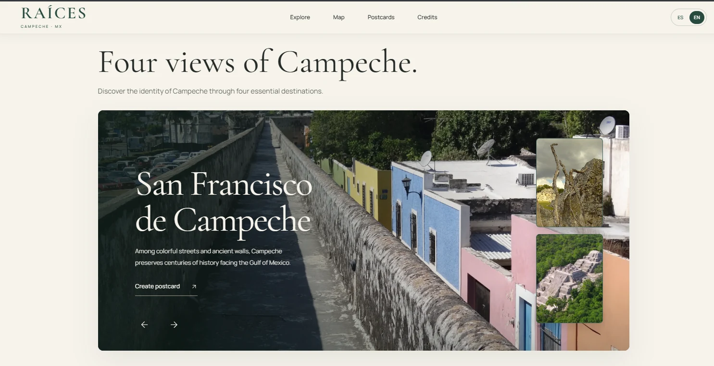

| Destination | Cultural Identity |
| --- | --- |
| San Francisco de Campeche | Colonial history and architecture |
| Edzná | Ancient Maya heritage |
| Calakmul | Archaeology and tropical nature |
| Isla Aguada | Coastal landscapes and traditions |

These destinations introduce the diversity of Campeche through photography and editorial storytelling.

### 03 — Explore Our Roots

The interactive exploration section connects cultural storytelling with geographic discovery.

Visitors can navigate between destinations, discover their locations, read cultural descriptions, and select a place to create a personalized postcard.

The geographic experience combines interactive SVG visualization, destination data, and reactive application state.


The map creates a connection between the region's geography and its cultural narratives.

### 04 — Create a Memory

RAÍCES transforms cultural exploration into a personal and creative experience through an interactive digital postcard editor.

Inspired by traditional travel correspondence, the postcard experience allows visitors to create visual memories connected to the landscapes, architecture, and cultural identity of Campeche.

#### Interactive Postcard Editor


Visitors can select a destination, apply photographic transformations, personalize their messages, preview both postcard faces, and export their creations.

The editor combines:

- Destination-based postcard compositions.
- Reactive application state.
- Cloudinary-powered photographic filters.
- Interactive front and back postcard faces.
- Three-dimensional postcard transitions.
- Editorial typography.
- A decorative Campeche-inspired wax seal.
- Personalized messages.
- Persistent postcard drafts.
- Responsive visual layouts.
- Individual PNG downloads.
- Combined ZIP downloads.

#### Double-Sided Postcard Experience

Traditional postcards communicate through both imagery and written memories.

RAÍCES brings this concept into a digital environment through an interactive double-sided postcard experience.

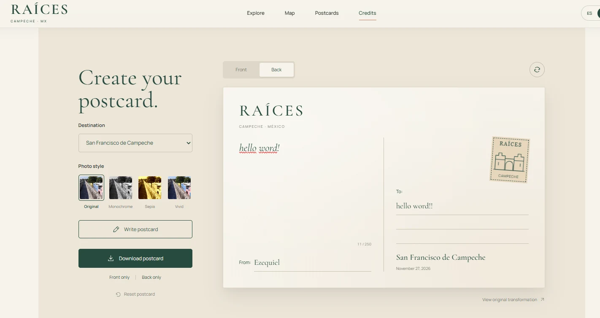

The front face focuses on destination photography, editorial typography, photographic attribution, and visual identity.

The reverse face introduces traditional correspondence elements, including:

- Personalized messages.
- Sender information.
- Recipient information.
- Destination details.
- Date information.
- Decorative postal elements.

Three-dimensional transitions reinforce the feeling of interacting with a tangible cultural object.

#### Creative Photography

The postcard editor offers four photographic styles powered by Cloudinary:

- Original.
- Monochrome.
- Sepia.
- Vivid.

These transformations allow visitors to reinterpret the same destination through different visual perspectives without maintaining separate manually edited photographs.

The technical implementation and visual comparisons are documented in the [Creative Image Transformations](#creative-image-transformations) section.

#### Expanded Editorial Gallery

The editorial gallery represents seven cultural and natural destinations across Campeche.

The gallery uses dynamic Angular templates and responsive compositions to present a broader collection of regional stories.

| Destination | Cultural Identity |
| --- | --- |
| San Francisco de Campeche | Colonial architecture and fortified heritage |
| Edzná | Ancient Maya civilization |
| Calakmul | Archaeological heritage and tropical forests |
| Isla Aguada | Coastal landscapes and maritime traditions |
| Bécal | Traditional craftsmanship and cultural identity |
| Hecelchakán | Regional history and local traditions |
| Palizada | Riverside architecture and cultural heritage |

Each destination contributes a different perspective on the cultural diversity of Campeche.

### 05 — A Cultural Farewell

The final section continues the editorial visual identity of the application through immersive photography, cultural messaging, navigation, and project information.


Rather than ending with a conventional footer, RAÍCES concludes the experience with a reflection on cultural identity and the importance of remembering where we come from.


---

## Key Features

| Feature | Description |
| --- | --- |
| Cinematic Hero | Immersive video-based introduction |
| Destination Carousel | Interactive navigation between featured destinations |
| Geographic Exploration | Interactive map with destination selection |
| Cultural Storytelling | Bilingual descriptions of regional heritage |
| Digital Postcards | Personalized visual memories inspired by Campeche |
| Double-Sided Postcards | Interactive front and back postcard compositions |
| 3D Postcard Transitions | Motion-driven postcard interactions |
| Editorial Gallery | Seven cultural and natural destinations |
| Creative Image Filters | Original, Monochrome, Sepia, and Vivid styles |
| Cloudinary Remote Fetch | Dynamic delivery of externally sourced photography |
| Image Transformations | Declarative resizing, cropping, quality, format, and effects |
| Reactive State | Application state managed through Angular Signals |
| Persistent Drafts | Browser-based preservation of postcard draft fields |
| Canvas Rendering | Programmatic generation of postcard images |
| PNG Export | Individual postcard face downloads |
| ZIP Export | Combined postcard face downloads using JSZip |
| Dynamic Templates | Reusable Angular postcard compositions |
| Responsive Design | Adaptable desktop, tablet, and mobile layouts |
| Internationalization | Spanish and English language support |
| Motion Design | Smooth transitions and subtle microinteractions |
| Photography Attribution | Original photography sources and licensing information |
| Optimized Documentation | WebP screenshots for project documentation |

---

## Cloudinary Integration

Cloudinary is a central component of the RAÍCES media architecture.

The application uses Cloudinary to transform and deliver destination photography dynamically, reducing the need to maintain multiple manually processed versions of the same image.

Media delivery is particularly important in an experience where photography plays a fundamental role in cultural storytelling.

Cloudinary contributes to two major aspects of the application:

1. **Media delivery:** Dynamic resizing, cropping, quality optimization, and format selection.
2. **Creative interaction:** Photographic transformations that allow visitors to personalize their postcards.

### Remote Image Fetching

Destination photographs originate from external photography sources, including Wikimedia Commons.

Cloudinary Remote Fetch enables the application to request transformed versions of these images through a centralized media delivery service.

This approach separates the original photography sources from the transformation and delivery process.

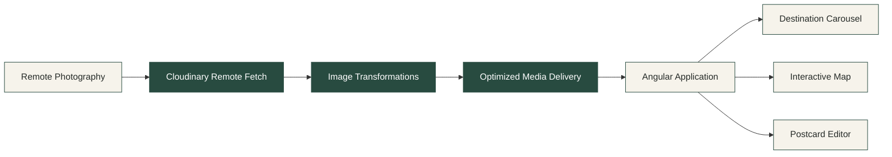

### Dynamic Image Transformations

The application constructs Cloudinary delivery URLs using transformation parameters that control dimensions, cropping, quality, delivery format, and optional photographic effects.

| Transformation | Purpose |
| --- | --- |
| `c_fill` | Fill the requested image dimensions |
| `w_1200` | Example requested image width |
| `h_744` | Corresponding image height |
| `q_auto` | Automatically select image quality |
| `f_auto` | Automatically select a supported image format |
| `e_grayscale` | Apply a monochrome effect |
| `e_sepia:70` | Apply a sepia effect |
| `e_saturation:35` | Increase color saturation |

The width is configurable, while the height is calculated using a consistent proportional relationship.

### Cloudinary URL Generation

The following implementation illustrates the URL generation logic used by the application's `CloudinaryService`.

```typescript
cloudUrl(
  destination: Destination,
  width = 1200,
  effect = ''
): string {
  const height = Math.round(width * 0.62);

  const transformations = [
    'c_fill',
    `w_${width}`,
    `h_${height}`,
    'q_auto',
    'f_auto'
  ];

  if (effect) {
    transformations.push(effect);
  }

  return (
    `https://res.cloudinary.com/${this.cloud}/image/fetch/` +
    `${transformations.join(',')}/` +
    encodeURIComponent(destination.url)
  );
}
```

This approach allows the application to generate different media representations from the same source photograph.

For example, a standard delivery URL follows this structure:

```text
https://res.cloudinary.com/<cloud-name>/image/fetch/c_fill,w_1200,h_744,q_auto,f_auto/<encoded-remote-image-url>
```

A monochrome representation adds the corresponding photographic transformation:

```text
https://res.cloudinary.com/<cloud-name>/image/fetch/c_fill,w_1200,h_744,q_auto,f_auto,e_grayscale/<encoded-remote-image-url>
```

The original photograph remains unchanged. Cloudinary delivers the requested transformed representation.

### Media Transformation Pipeline

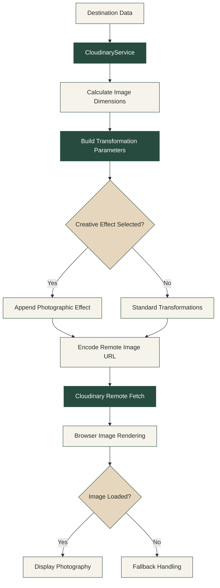

### Error Handling

The application includes fallback handling for destination photography when remote image delivery encounters an error.

This helps maintain the visual experience when an external photography source or transformed image cannot be loaded.

Browser-based postcard export has additional requirements because Canvas must be permitted to access the image data.

Consequently, successful image rendering in the interface does not necessarily guarantee successful Canvas export.

### Why Cloudinary?

Cloudinary supports the project's visual experience by providing:

- Centralized image transformation.
- Dynamic image resizing.
- Automatic quality optimization.
- Automatic image format selection.
- Remote media delivery.
- Declarative photographic effects.
- Reusable media transformation URLs.
- Creative personalization without manually generating every image variant.

By combining Cloudinary with Angular, RAÍCES can focus on cultural storytelling and creative interaction while using a dedicated media delivery infrastructure.

---

## Creative Image Transformations

One of the central creative features of RAÍCES is its interactive photographic transformation system.

Instead of storing four independently edited versions of each destination photograph, the application constructs Cloudinary URLs according to the selected photographic style.

This allows the same source image to be presented through different visual interpretations.

### Available Photographic Styles

| Style | Cloudinary Effect | Visual Purpose |
| --- | --- | --- |
| Original | No additional effect | Preserve the original photographic appearance |
| Monochrome | `e_grayscale` | Emphasize contrast, structure, and architectural detail |
| Sepia | `e_sepia:70` | Create a warm, historical photographic interpretation |
| Vivid | `e_saturation:35` | Enhance the intensity of the original colors |

### Visual Comparison

The following screenshots demonstrate the four photographic styles using the same destination: San Francisco de Campeche.

<table>
  <tr>
    <td width="50%" align="center">
      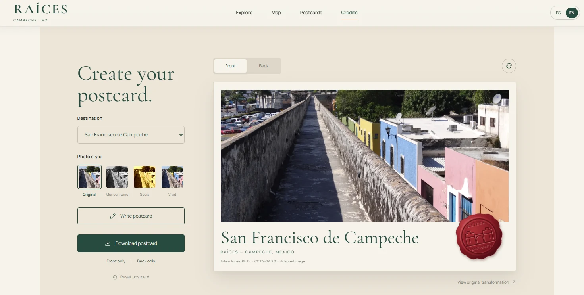
      <br />
      <strong>Original</strong>
      <br />
      <sub>No additional photographic effect</sub>
    </td>
    <td width="50%" align="center">
      
      <br />
      <strong>Monochrome</strong>
      <br />
      <code>e_grayscale</code>
    </td>
  </tr>
  <tr>
    <td width="50%" align="center">
      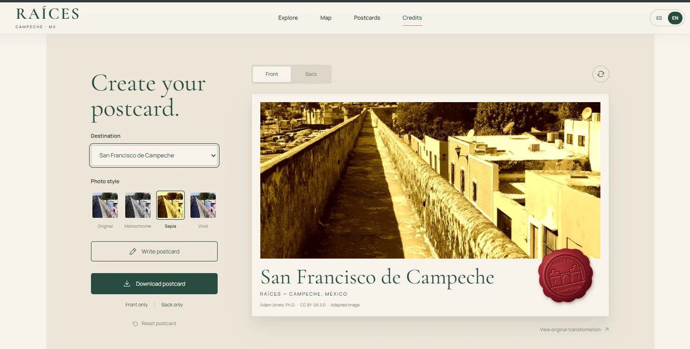
      <br />
      <strong>Sepia</strong>
      <br />
      <code>e_sepia:70</code>
    </td>
    <td width="50%" align="center">
      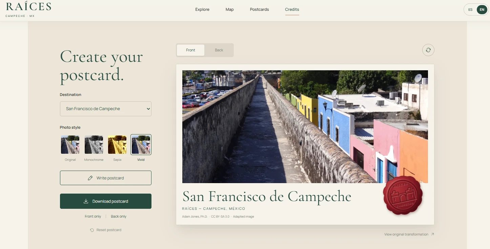
      <br />
      <strong>Vivid</strong>
      <br />
      <code>e_saturation:35</code>
    </td>
  </tr>
</table>

<p align="center">
  <sub>
    Four photographic interpretations of the same destination.
    Original photography by Adam Jones, Ph.D. — CC BY-SA 3.0.
  </sub>
</p>

### Reactive Transformation Selection

The selected photographic style forms part of the postcard's reactive application state.

Angular Signals and computed values allow the application to derive the corresponding image representation when the selected destination or photographic style changes.

The following conceptual diagram describes this interaction:


This approach separates user interaction from media transformation logic.

The postcard editor manages the selected creative state, while Cloudinary handles the requested photographic representation.

### Cloudinary Resources

- [Cloudinary Documentation](https://cloudinary.com/documentation)
- [Image Transformations](https://cloudinary.com/documentation/image_transformations)
- [Fetch Remote Images](https://cloudinary.com/documentation/fetch_remote_images)
- [Image Optimization](https://cloudinary.com/documentation/image_optimization)
- [Transformation Reference](https://cloudinary.com/documentation/transformation_reference)

---

## Postcard Engineering

The postcard experience is more than a visual interface.

It combines reactive state management, dynamic media transformations, browser storage, programmatic rendering, and file generation.

### Reactive Postcard State

The postcard service manages the information required to personalize the postcard experience.

This includes:

- Selected destination.
- Selected photographic style.
- Personalized message.
- Sender information.
- Recipient information.
- Derived image representations.

Angular Signals provide a reactive mechanism for managing application state and deriving values from user selections.

The destination selection service also provides shared destination state across different parts of the application.

### Persistent Drafts

RAÍCES uses browser `localStorage` to preserve selected postcard draft fields.

The persisted information includes:

- Personalized message.
- Sender information.
- Recipient information.
- Selected photographic filter.

This allows visitors to recover their creative progress after returning to the application in the same browser, subject to browser storage availability.

The persistence mechanism is local to the browser and does not represent cloud synchronization or server-side user accounts.

### Browser-Based Canvas Rendering

The downloadable postcards are generated programmatically using the HTML5 Canvas API.

The export process creates postcard images with a resolution of:

<div align="center">

  <h2>1600 × 1000 pixels</h2>

  <p>Browser-generated digital postcard composition</p>

</div>

Canvas rendering combines visual elements such as:

- Destination photography.
- Background colors.
- Editorial typography.
- Destination information.
- Personalized correspondence.
- Decorative elements.
- Photography attribution.

The exported images are generated from postcard data and rendering logic rather than simply capturing a screenshot of the editor.

### Export Formats

| Format | Description |
| --- | --- |
| Front PNG | Download the front postcard composition |
| Back PNG | Download the reverse postcard composition |
| ZIP | Download both postcard faces in a single archive |

JSZip is used to package the generated postcard images into a downloadable ZIP archive.

### Postcard Generation Pipeline

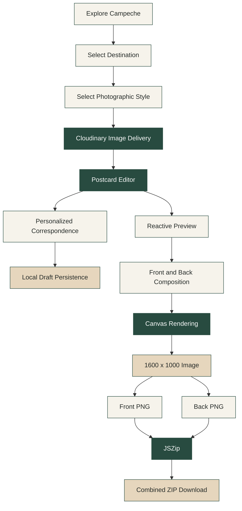

### Cross-Origin Image Considerations

Because the application uses remotely sourced photography, Canvas rendering must account for cross-origin restrictions.

A remote image may be displayed successfully in the browser while still being unavailable for pixel extraction or image export.

The postcard generation logic includes error handling for image-loading and export failures.

### Photography Attribution in Exports

Cultural photography is an essential part of RAÍCES.

The postcard rendering process incorporates attribution information associated with the original photography, including the author, applicable license, source information, and adaptation notice.

Photographic transformations do not remove the obligations associated with the original image license.

---

## Documentation Asset Optimization

The visual documentation of RAÍCES includes original PNG screenshots and optimized WebP versions.

WebP assets are used throughout this README to reduce documentation image weight while preserving the original image dimensions and visual detail.

### Asset Organization

| Format | Purpose |
| --- | --- |
| PNG | Original project screenshots |
| WebP | Optimized documentation and technical articles |

The optimized screenshots are stored in:

```text
public/assets/webp/
```

### Documentation Image Inventory

| Asset | Description |
| --- | --- |
| `hero.webp` | Cinematic homepage |
| `wherehistory.webp` | Cultural introduction |
| `fourview.webp` | Interactive destination carousel |
| `Explore.webp` | Interactive exploration map |
| `memory.webp` | Interactive postcard editor featuring Calakmul |
| `memory2.webp` | Double-sided postcard experience |
| `memoryOriginal.webp` | Original photographic style |
| `memorymonochrome.webp` | Monochrome photographic transformation |
| `memorysepia.webp` | Sepia photographic transformation |
| `memoryvivid.webp` | Vivid photographic transformation |
| `footer1.webp` | Cultural closing section |
| `footer2.webp` | Footer and project credits |

### Documentation Optimization Workflow

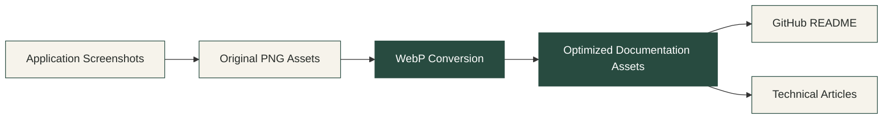

The documentation screenshots are optimized separately from the application's Cloudinary-powered media delivery pipeline.

The WebP documentation assets are pre-generated screenshots, while Cloudinary dynamically transforms the destination photography used within the application.

This distinction separates documentation optimization from runtime media processing.

---

## Design Philosophy

RAÍCES follows a contemporary editorial design inspired by cultural magazines, photography exhibitions, traditional travel postcards, and immersive travel experiences.

The interface prioritizes photography, typography, whitespace, composition, and storytelling rather than excessive decorative elements.

The design aims to establish an emotional connection between the visitor and the cultural identity of Campeche.

### Color Palette

| Color | Hex | Inspiration |
| --- | --- | --- |
| Colonial White | `#F6F3EB` | Historic colonial architecture |
| Forest Green | `#284B40` | The Maya jungle |
| Natural Sand | `#E6D6BD` | Limestone and ancient structures |
| Terracotta | `#C47D65` | Traditional architecture |
| Coastal Blue | `#709B9B` | The Gulf of Mexico |
| Charcoal | `#262B28` | Editorial typography |

### Typography

- **Cormorant Garamond** — Editorial headings and cultural storytelling.
- **Manrope** — Navigation, descriptions, and interface elements.

The combination establishes a visual hierarchy that balances expressive cultural narratives with functional interface design.

### Motion Design

Animations are designed to complement the experience without distracting from its cultural content.

The visual language includes:

- Smooth entrance animations.
- Destination transitions.
- Interactive navigation.
- Subtle hover effects.
- Responsive microinteractions.
- Three-dimensional postcard transitions.
- Editorial gallery interactions.
- Reduced-motion considerations.

### Editorial Postcard Design

The postcard experience draws inspiration from traditional printed correspondence and contemporary editorial compositions.

Its visual identity combines:

- Destination photography.
- Expressive typography.
- Traditional postcard layouts.
- Decorative cultural details.
- A Campeche-inspired wax seal.
- Front and back compositions.
- Multiple photographic interpretations.
- Traditional postal elements.

These elements reinforce the connection between digital interaction and physical cultural memories.

---

## Technology Stack

### Frontend

| Technology | Purpose |
| --- | --- |
| Angular 22 | Application framework |
| TypeScript | Type-safe application development |
| Angular Signals | Reactive application state |
| Angular Templates | Dynamic editorial compositions |
| Tailwind CSS | Utility-based styling |
| CSS | Custom editorial layouts and animations |
| GSAP | Motion design |
| SVG | Interactive geographic visualization |
| HTML5 Video | Cinematic media experience |

### Media and Creative Engineering

| Technology | Purpose |
| --- | --- |
| Cloudinary | Media transformations and delivery |
| Cloudinary Remote Fetch | Delivery of externally sourced photography |
| HTML5 Canvas API | Programmatic postcard image generation |
| JSZip | Combined postcard archive generation |
| Browser localStorage | Local postcard draft persistence |
| Wikimedia Commons | Source photography |
| GeoJSON | Geographic data |
| WebP | Optimized documentation screenshots |

### Development and Deployment

| Technology | Purpose |
| --- | --- |
| pnpm | Dependency management |
| Git | Version control |
| GitHub | Source code management |
| Vercel | Frontend deployment |

---

## Application Architecture

RAÍCES follows a modular Angular architecture with reusable components, centralized services, reactive application state, and separated application data.

The architecture is organized around four major concerns:

- Presentation and user interaction.
- Reactive application state.
- Media transformation and delivery.
- Postcard generation and export.

### High-Level Architecture

The following conceptual architecture diagram summarizes the responsibilities of the application's main components and services.

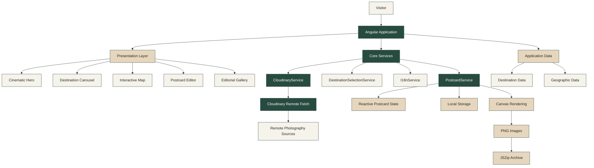

### Core Services

| Service | Responsibility |
| --- | --- |
| `CloudinaryService` | Dynamic image URL generation, transformations, and fallback handling |
| `DestinationSelectionService` | Shared reactive destination selection |
| `I18nService` | Spanish and English language management |
| `PostcardService` | Postcard state, photographic styles, draft persistence, rendering, and export |

### Separation of Responsibilities

The application separates cultural content from presentation logic and media processing.

Destination data provides the information required to represent cultural locations.

The destination selection service coordinates shared destination state.

CloudinaryService encapsulates media transformation URL generation.

PostcardService manages creative postcard information, rendering, and export responsibilities.

The presentation layer focuses on displaying the experience and handling user interaction.

### Project Structure

The following tree highlights the principal application directories and documentation assets.

```text
frontend/
├── public/
│   ├── assets/
│   │   ├── Explore.png
│   │   ├── footer1.png
│   │   ├── footer2.png
│   │   ├── fourview.png
│   │   ├── hero.png
│   │   ├── memory.png
│   │   ├── memory2.png
│   │   ├── memoryOriginal.png
│   │   ├── memorymonochrome.png
│   │   ├── memorysepia.png
│   │   ├── memoryvivid.png
│   │   ├── wherehistory.png
│   │   └── webp/
│   │       ├── Explore.webp
│   │       ├── footer1.webp
│   │       ├── footer2.webp
│   │       ├── fourview.webp
│   │       ├── hero.webp
│   │       ├── memory.webp
│   │       ├── memory2.webp
│   │       ├── memoryOriginal.webp
│   │       ├── memorymonochrome.webp
│   │       ├── memorysepia.webp
│   │       ├── memoryvivid.webp
│   │       └── wherehistory.webp
│   ├── maps/
│   │   └── campeche.geojson
│   └── hero.mp4
│
├── src/
│   ├── app/
│   │   ├── core/
│   │   │   └── services/
│   │   ├── data/
│   │   ├── features/
│   │   ├── shared/
│   │   │   └── components/
│   │   ├── app.config.ts
│   │   ├── app.routes.ts
│   │   ├── app.html
│   │   ├── app.css
│   │   └── app.ts
│   ├── index.html
│   ├── main.ts
│   └── styles.css
│
├── angular.json
├── package.json
├── pnpm-lock.yaml
├── vercel.json
└── README.md
```

---

## Getting Started

### Prerequisites

Before running the project locally, make sure you have:

- Node.js compatible with Angular 22.
- pnpm.
- Git.
- A modern web browser.

### Installation

Clone the repository:

```bash
git clone https://github.com/Ezequie1Sc/frontend.git
```

Navigate to the project directory:

```bash
cd frontend
```

Install the dependencies:

```bash
pnpm install
```

Start the development server:

```bash
pnpm start
```

Open the application in your browser:

```text
http://localhost:4200
```

### Production Build

Generate the production build:

```bash
pnpm build
```

### Cloudinary Configuration

The Cloudinary media configuration is managed through the application's Cloudinary service.

To use a different Cloudinary product environment, update the public cloud name in:

```text
src/app/core/services/cloudinary.service.ts
```

Remote Fetch must be permitted by the corresponding Cloudinary product environment.

Private API secrets must never be exposed in frontend source code or committed to the repository.

### Live Deployment

The application is deployed using Vercel.

- **Live application:** [Explore RAÍCES](https://frontend-iche.vercel.app/)
- **Source code:** [GitHub Repository](https://github.com/Ezequie1Sc/frontend)
- **Video demonstration:** [Watch on YouTube](https://www.youtube.com/watch?v=XDvKn_bbwCA)

---

## Internationalization

RAÍCES is designed to be accessible to both local and international visitors.

The application supports:

- Spanish (ES).
- English (EN).

Visitors can switch languages directly from the navigation interface.

Cultural descriptions, navigation labels, interface actions, and editorial content adapt to the selected language.

Internationalization helps make the cultural heritage of Campeche available to a broader audience while preserving its regional identity.

---

## Responsive Experience

The application is designed for multiple screen sizes, including:

- Desktop computers.
- Laptops.
- Tablets.
- Mobile devices.

Layouts adapt to the available screen space while preserving the editorial identity and core exploration experience.

Responsive considerations include:

- Adaptive typography.
- Flexible destination layouts.
- Responsive media compositions.
- Mobile-friendly navigation.
- Interactive geographic visualization.
- Adaptive postcard compositions.
- Responsive editorial galleries.

The objective is to maintain a consistent cultural experience across different devices.

---

## Photography and Attribution

RAÍCES uses externally sourced photography to represent the cultural and geographic identity of Campeche.

Original photography remains subject to the rights of its respective authors and the applicable licensing conditions.

| Destination | Photographer / Contributor | Source |
| --- | --- | --- |
| San Francisco de Campeche | Adam Jones, Ph.D. | [Wikimedia Commons](https://commons.wikimedia.org/wiki/File:Old_City_Walls_and_Colonial_Facades_-_Campeche_-_Mexico.jpg) |
| Edzná | Adam Jones, Ph.D. | [Wikimedia Commons](https://commons.wikimedia.org/wiki/File:Edzna_Archaeological_Site_with_Flash_-_Campeche_State_-_Mexico.jpg) |
| Calakmul | Lugares INAH | [Wikimedia Commons](https://commons.wikimedia.org/wiki/File:Calakmul_Structure_2.jpg) |
| Isla Aguada | Bernard DUPONT | [Wikimedia Commons](https://commons.wikimedia.org/wiki/File:Colorful_Sea_Side_-_Isla_Aguada_Campeche.jpg) |

Additional attribution information is available within the application and its destination data.

### Adapted Photography

Cloudinary transformations create alternative representations of the original photographs.

These transformations may include:

- Resizing.
- Cropping.
- Grayscale conversion.
- Sepia effects.
- Saturation adjustments.
- Format and quality optimization.

Photographic transformations do not transfer ownership of the original media.

Adapted postcards, transformed photographs, and documentation screenshots containing third-party media must comply with the applicable source image licenses.

---

## Hackathon Submission

<div align="center">

  <h3>Cloudinary November Mini-Hack 2026</h3>

  <p>Celebrate Where You're From!</p>

</div>

| Information | Details |
| --- | --- |
| Project | RAÍCES — Discover Campeche |
| Event | Cloudinary November Mini-Hack 2026 |
| Theme | Celebrate Where You're From! |
| Region | Campeche, Mexico |
| Country | Mexico |
| Category | Cultural exploration and creative media |
| Media Platform | Cloudinary |
| Developer | Orlando Ezequiel Salazar Cruz |
| Frontend Framework | Angular 22 |
| Deployment | Vercel |

### The Challenge

The challenge encourages developers to celebrate the places they come from through creative technology and media experiences.

RAÍCES responds to this theme by transforming the cultural identity of Campeche into an interactive digital journey.

By combining authentic photography, geographic exploration, cinematic storytelling, and personalized postcards, the project creates a connection between technology, cultural heritage, and personal identity.

### Project Objectives

| Objective | Implementation |
| --- | --- |
| Celebrate local culture | Interactive exploration of Campeche |
| Encourage discovery | Destination carousel and geographic visualization |
| Integrate creative media | Cloudinary-powered photography |
| Promote personal expression | Interactive digital postcards |
| Enable creative transformations | Dynamic photographic styles |
| Generate meaningful memories | Downloadable personalized postcards |
| Deliver visual storytelling | Editorial design and cinematic presentation |
| Reach international audiences | Spanish and English support |

### Submission Resources

| Resource | Link |
| --- | --- |
| Live Application | [Explore RAÍCES](https://frontend-iche.vercel.app/) |
| Source Code | [GitHub Repository](https://github.com/Ezequie1Sc/frontend) |
| Video Demonstration | [YouTube](https://www.youtube.com/watch?v=XDvKn_bbwCA) |
| Media Infrastructure | [Cloudinary](https://cloudinary.com/) |
| Technical Article | [Read on DEV Community](https://dev.to/ezequie1sc/raices-discover-campeche-engineering-a-cultural-web-experience-with-angular-22-and-cloudinary-1ci2) |
| Technical Publications | [DEV Community Profile](https://dev.to/ezequie1sc) |

---

## Development Evolution

RAÍCES has evolved through multiple development iterations, expanding its original cultural exploration experience with new creative and editorial features.

### Initial Experience

- Cinematic introduction.
- Cultural storytelling.
- Featured destination carousel.
- Interactive geographic exploration.
- Initial postcard creation experience.
- Cloudinary media integration.

### Premium Experience

- Refined editorial visual identity.
- Improved interactive layouts.
- Enhanced motion design.
- Responsive visual compositions.

### Premium Postcard Experience

- Double-sided postcard compositions.
- Three-dimensional postcard interactions.
- Campeche-inspired wax seal.
- Reactive postcard editor state.
- Persistent postcard drafts.
- Additional cultural destinations.

### Expanded Editorial Gallery

- Seven cultural and natural destinations.
- Dynamic Angular postcard templates.
- Expanded editorial compositions.
- Improved responsive gallery layouts.

### Creative Media and Engineering Documentation

- Original, Monochrome, Sepia, and Vivid photographic styles.
- Visual comparison of Cloudinary transformations.
- Documentation of dynamic transformation URL generation.
- Documentation of browser-based Canvas rendering.
- Documentation of PNG and ZIP export capabilities.
- Twelve optimized WebP documentation assets.
- Expanded architecture diagrams.
- Improved technical explanations.
- Community contribution guidelines.

---

## Future Improvements

Potential future developments include:

- Additional cultural destinations.
- Expanded photography collections.
- More detailed geographic exploration.
- Additional postcard templates.
- Additional creative photographic transformations.
- Interactive cultural timelines.
- Digital travel collections.
- Expanded accessibility features.
- Additional internationalization options.
- Further media delivery optimization.
- Expanded cultural storytelling experiences.
- Community-driven cultural content.
- Additional automated testing.

These improvements would continue the project's objective of connecting cultural heritage with creative technology.

---

## Contributing

RAÍCES welcomes feedback, ideas, and contributions from developers, designers, cultural enthusiasts, and members of the Cloudinary community.

This project is an opportunity to explore how modern web technologies and creative media can help share cultural heritage.

Whether you are interested in Angular, Cloudinary, frontend engineering, visual storytelling, or cultural preservation, you are welcome to explore the repository and suggest improvements.

### Ways to Contribute

| Area | Contribution Opportunities |
| --- | --- |
| Frontend Engineering | Angular components, architecture, and reactive state |
| Cloudinary | Image transformations and media delivery improvements |
| UI/UX Design | Editorial layouts, interaction design, and accessibility |
| Cultural Content | Destination descriptions and cultural information |
| Photography | Properly licensed cultural photography |
| Internationalization | Translation and language improvements |
| Documentation | Technical explanations, examples, and tutorials |
| Quality Assurance | Bug reports, testing, and compatibility improvements |

### Contribution Workflow

1. Fork the repository.
2. Clone your fork.
3. Create a dedicated branch.
4. Implement and review your changes.
5. Verify the application locally.
6. Commit your changes.
7. Push your branch.
8. Open a pull request.

Example:

```bash
git checkout -b feat/improve-postcard-experience
```

After completing your changes:

```bash
git add .
git commit -m "feat: improve postcard experience"
git push origin feat/improve-postcard-experience
```

### Contribution Guidelines

- Respect the cultural identity and historical context of Campeche.
- Preserve the editorial visual identity of the project.
- Follow the existing Angular architecture and coding conventions.
- Include meaningful commit messages.
- Verify responsive behavior when modifying visual components.
- Never commit private credentials or API secrets.
- Respect third-party photography licenses and attribution requirements.
- Document significant technical changes.

### Feedback and Discussions

If you have ideas, suggestions, or feedback, feel free to open an issue or submit a pull request.

- [Open an Issue](https://github.com/Ezequie1Sc/frontend/issues/new)
- [Explore Existing Issues](https://github.com/Ezequie1Sc/frontend/issues)
- [View Pull Requests](https://github.com/Ezequie1Sc/frontend/pulls)

I would especially welcome feedback from developers experimenting with Cloudinary, Angular, creative media, and interactive digital experiences.

> The most meaningful projects are not only built for people, but also improved together with them.

---

## Author

<div align="center">

  

  <h3>Orlando Ezequiel Salazar Cruz</h3>

  <p>
    Computer Systems Engineering Student<br />
    Full Stack Developer<br />
    Campeche, Mexico
  </p>

  <p>
    Interested in software engineering, creative development,
    open-source technologies, technical writing,
    and meaningful digital experiences.
  </p>

  <a href="https://github.com/Ezequie1Sc">
    
  </a>

  <a href="https://dev.to/ezequie1sc">
    
  </a>

  <a href="https://ezequiel-dev-ia.vercel.app/">
    
  </a>

</div>

---

## Technical Article

Explore the engineering decisions, editorial design, and technical architecture behind RAÍCES in my detailed DEV Community article.

### RAÍCES — Discover Campeche: Engineering a Cultural Web Experience with Angular 22 and Cloudinary

[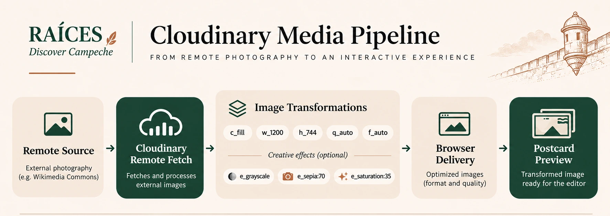](https://dev.to/ezequie1sc/raices-discover-campeche-engineering-a-cultural-web-experience-with-angular-22-and-cloudinary-1ci2)

The article covers:

- Cloudinary Remote Fetch and dynamic image transformations.
- Reactive architecture with Angular Signals.
- Interactive geographic exploration.
- Double-sided digital postcards.
- HTML5 Canvas rendering and PNG/ZIP exports.
- Cultural storytelling through editorial design.
- Engineering decisions and lessons learned.

[**Read the full article on DEV Community →**](https://dev.to/ezequie1sc/raices-discover-campeche-engineering-a-cultural-web-experience-with-angular-22-and-cloudinary-1ci2)

Feedback, technical discussions, and community contributions are welcome.

---

## Acknowledgments

Special thanks to:

- Cloudinary for providing the media infrastructure and creative challenge.
- The Cloudinary developer community for encouraging creative technology, experimentation, and collaboration.
- Wikimedia Commons contributors for sharing cultural photography.
- The Angular community for building and maintaining modern web development technologies.
- The communities that preserve the history and traditions of Campeche.
- Everyone working to protect and celebrate Mexico's cultural heritage.
- Developers and creators who share their knowledge and help others grow.

RAÍCES is a celebration of the places, people, landscapes, and stories that shape our identity.

---

<div align="center">

  <h1>RAÍCES</h1>

  <h3>Discover the land. Remember the stories. Celebrate your roots.</h3>

  <p>
    Technology can do more than solve problems.<br />
    It can preserve memories, connect communities,<br />
    and bring our stories to the world.
  </p>

  <p><strong>Designed and developed in Campeche, Mexico.</strong></p>

  <sub>2026 · RAÍCES — Discover Campeche</sub>

</div>
