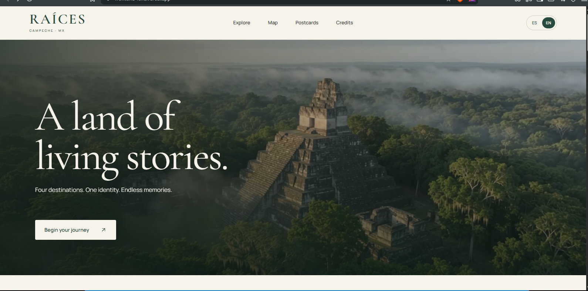
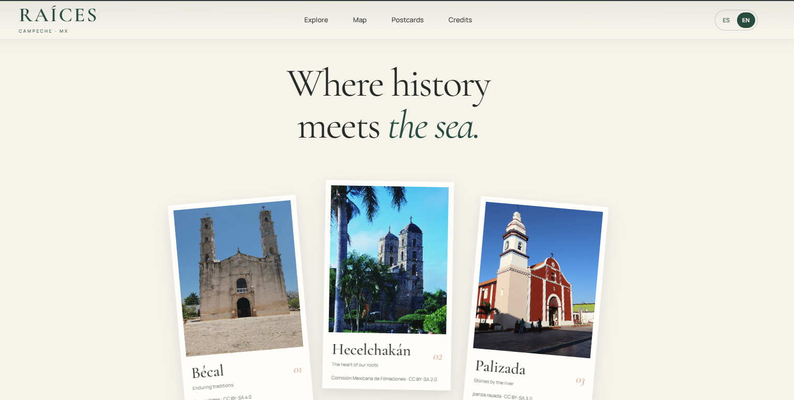
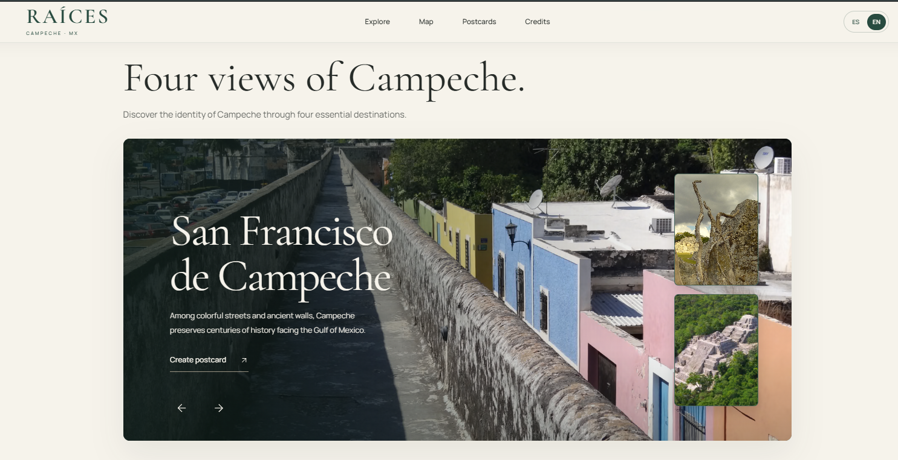
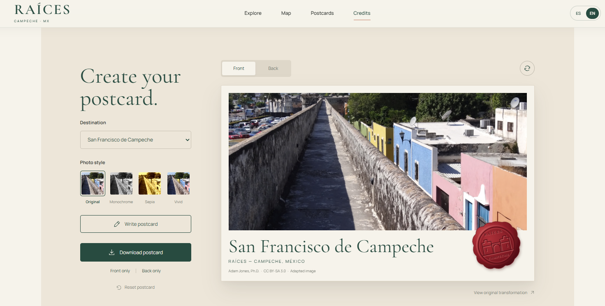
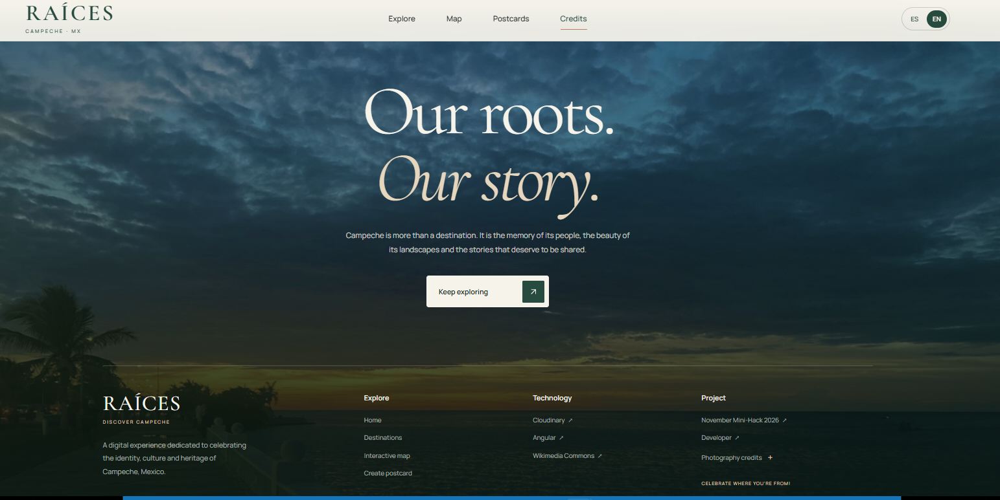
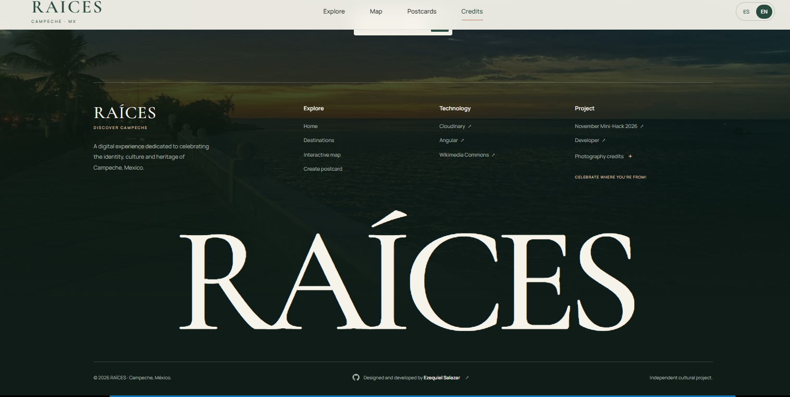

# RAÍCES — Discover Campeche

<div align="center">

  <h3>A land of living stories.</h3>

  <p>
    An interactive cultural experience celebrating the history,
    landscapes, and identity of Campeche, Mexico.
  </p>

  

  <br />
  <br />

  
  
  
  
  
  

  **Cloudinary November Mini-Hack 2026**

  *Celebrate Where You're From!*

</div>

---

## About the Project

**RAÍCES — Discover Campeche** is an interactive digital experience designed to celebrate the cultural heritage, natural beauty, and historical identity of Campeche, Mexico.

Rather than creating a conventional tourism website, RAÍCES presents the region through an immersive editorial experience where photography, storytelling, interactive exploration, and personalized digital postcards come together.

The project invites visitors to discover a territory shaped by ancient Maya civilizations, colonial architecture, tropical landscapes, and coastal traditions.

> Every place has a story. Every story has roots.

---

## Inspiration

Campeche is more than a destination.

It is a territory where centuries of history coexist with everyday traditions, colorful architecture, ancient archaeological sites, and the waters of the Gulf of Mexico.

As a developer from Campeche, I wanted to create an experience that celebrates the place I come from while combining technology, visual storytelling, and cultural identity.

RAÍCES is my way of sharing a part of Mexico that deserves to be discovered, remembered, and celebrated.



---

## The Experience

### 01 — Cinematic Introduction

The experience begins with an immersive cinematic hero that introduces the atmosphere and identity of Campeche.

The interface combines:

- Full-width cinematic video.
- Elegant editorial typography.
- Subtle entrance animations.
- Responsive layouts.
- Minimal visual distractions.
- Bilingual storytelling.


### 02 — Four Views of Campeche

An interactive destination carousel allows visitors to discover four essential perspectives of the region.

Each destination includes authentic photography, cultural descriptions, navigation controls, and direct access to the postcard creation experience.



| Destination | Cultural Identity |
| --- | --- |
| San Francisco de Campeche | Colonial history and architecture |
| Edzná | Ancient Maya heritage |
| Calakmul | Archaeology and tropical nature |
| Isla Aguada | Coastal landscapes and traditions |

### 03 — Explore Our Roots

The interactive exploration section connects cultural storytelling with geographic discovery.

Visitors can navigate between destinations, discover their locations, read cultural descriptions, and select a place to create a personalized postcard.


### 04 — Create a Memory

RAÍCES transforms cultural exploration into a personal experience through digital postcard creation.

Visitors can select a destination and create a visual memory inspired by the landscapes and identity of Campeche.

This feature connects the exploration experience with Cloudinary-powered image processing.



### 05 — A Cultural Farewell

The final section continues the editorial visual identity of the application through immersive photography, cultural messaging, navigation, and project information.





---

## Key Features

| Feature | Description |
| --- | --- |
| Cinematic Hero | Immersive video-based introduction |
| Destination Carousel | Interactive navigation between cultural destinations |
| Geographic Exploration | Interactive map with destination selection |
| Cultural Storytelling | Bilingual descriptions of regional heritage |
| Digital Postcards | Personalized visual memories inspired by Campeche |
| Cloudinary Integration | Remote image fetching, transformations, and optimized delivery |
| Responsive Design | Adaptable desktop, tablet, and mobile layouts |
| Internationalization | Spanish and English language support |
| Motion Design | Smooth transitions and subtle microinteractions |
| Photography Attribution | Original photography sources and licensing information |

---

## Cloudinary Integration

Cloudinary is a central part of the RAÍCES media experience.

The application uses Cloudinary to transform and deliver destination photography dynamically, reducing the need to maintain multiple manually processed versions of the same image.

### Remote Image Fetching

Destination photographs originate from external photography sources, including Wikimedia Commons.

Cloudinary Remote Fetch enables the application to request transformed versions of these images through a centralized media delivery service.

### Dynamic Image Transformations

Images are processed using transformation parameters that control dimensions, cropping, quality, and delivery format.

| Transformation | Purpose |
| --- | --- |
| `c_fill` | Fill the requested image dimensions |
| `w_1200` | Set the requested image width |
| `h_744` | Set the requested image height |
| `q_auto` | Automatically select image quality |
| `f_auto` | Automatically select a supported image format |

Example transformation URL:

```text
https://res.cloudinary.com/<cloud-name>/image/fetch/
c_fill,w_1200,h_744,q_auto,f_auto/<remote-image-url>
```

### Image Delivery Flow


### Why Cloudinary?

Cloudinary supports the project's visual experience by providing:

- Centralized image transformation.
- Dynamic image resizing.
- Automatic quality optimization.
- Automatic image format selection.
- Remote media delivery.
- Image processing for creative experiences.

The application also includes fallback handling for destination photography when remote image delivery encounters an error.

---

## Design Philosophy

RAÍCES follows a contemporary editorial design inspired by cultural magazines, photography exhibitions, and immersive travel experiences.

The interface prioritizes photography, typography, whitespace, and storytelling rather than excessive decorative elements.

### Color Palette

| Color | Hex | Inspiration |
| --- | --- | --- |
| Colonial White | `#F6F3EB` | Historic colonial architecture |
| Forest Green | `#284B40` | The Maya jungle |
| Natural Sand | `#E6D6BD` | Limestone and ancient structures |
| Terracotta | `#C47D65` | Traditional architecture |
| Coastal Blue | `#709B9B` | The Gulf of Mexico |
| Charcoal | `#262B28` | Editorial typography |

### Typography

- **Cormorant Garamond** — Editorial headings and cultural storytelling.
- **Manrope** — Navigation, descriptions, and interface elements.

### Motion Design

Animations are designed to complement the experience without distracting from its cultural content.

The visual language includes:

- Smooth entrance animations.
- Destination transitions.
- Interactive navigation.
- Subtle hover effects.
- Responsive microinteractions.
- Reduced-motion considerations.

---

## Technology Stack

### Frontend

| Technology | Purpose |
| --- | --- |
| Angular 22 | Application framework |
| TypeScript | Type-safe application development |
| Angular Signals | Reactive application state |
| Tailwind CSS | Utility-based styling |
| CSS | Custom editorial layouts and animations |
| GSAP | Motion design |
| SVG | Interactive geographic visualization |
| HTML5 Video | Cinematic media experience |

### Media Infrastructure

| Technology | Purpose |
| --- | --- |
| Cloudinary | Media transformations and delivery |
| Wikimedia Commons | Source photography |
| GeoJSON | Geographic data |

### Development and Deployment

| Technology | Purpose |
| --- | --- |
| pnpm | Dependency management |
| Git | Version control |
| GitHub | Source code management |
| Vercel | Frontend deployment |

---

## Application Architecture

RAÍCES follows a modular Angular architecture with reusable components, centralized services, and separated application data.

```text
frontend/
├── public/
│   ├── assets/
│   │   ├── Explore.png
│   │   ├── footer1.png
│   │   ├── footer2.png
│   │   ├── fourview.png
│   │   ├── hero.png
│   │   ├── memory.png
│   │   └── wherehistory.png
│   ├── maps/
│   │   └── campeche.geojson
│   └── hero.mp4
│
├── src/
│   ├── app/
│   │   ├── core/
│   │   │   └── services/
│   │   ├── data/
│   │   ├── features/
│   │   ├── shared/
│   │   │   └── components/
│   │   ├── app.config.ts
│   │   ├── app.routes.ts
│   │   ├── app.html
│   │   ├── app.css
│   │   └── app.ts
│   ├── index.html
│   ├── main.ts
│   └── styles.css
│
├── angular.json
├── package.json
├── pnpm-lock.yaml
├── vercel.json
└── README.md
```

### Core Services

| Service | Responsibility |
| --- | --- |
| `CloudinaryService` | Image transformations and fallback handling |
| `DestinationSelectionService` | Shared destination selection |
| `I18nService` | Spanish and English language management |
| `PostcardService` | Postcard creation state and interactions |

---

## Getting Started

### Prerequisites

Before running the project locally, make sure you have:

- Node.js compatible with Angular 22.
- pnpm.
- Git.
- A modern web browser.

### Installation

Clone the repository:

```bash
git clone https://github.com/Ezequie1Sc/raices-discover-campeche.git
```

Navigate to the frontend directory:

```bash
cd raices-discover-campeche/frontend
```

Install the dependencies:

```bash
pnpm install
```

Start the development server:

```bash
pnpm start
```

Open the application in your browser:

```text
http://localhost:4200
```

### Production Build

Generate the production build:

```bash
pnpm build
```

### Cloudinary Configuration

The Cloudinary media configuration is managed through the application's Cloudinary service.

To use a different Cloudinary product environment, update the public cloud name in:

```text
src/app/core/services/cloudinary.service.ts
```

Remote Fetch must be permitted by the corresponding Cloudinary product environment.

Private API secrets must never be exposed in frontend source code or committed to the repository.

---

## Internationalization

RAÍCES is designed to be accessible to both local and international visitors.

The application supports:

- Spanish (ES).
- English (EN).

Visitors can switch languages directly from the navigation interface.

Cultural descriptions, navigation labels, interface actions, and editorial content adapt to the selected language.

---

## Responsive Experience

The application is designed for multiple screen sizes, including:

- Desktop computers.
- Laptops.
- Tablets.
- Mobile devices.

Layouts adapt to the available screen space while preserving the editorial identity and core exploration experience.

---

## Photography and Attribution

RAÍCES uses externally sourced photography to represent the cultural and geographic identity of Campeche.

Original photography remains the property of its respective authors and is subject to its original licensing conditions.

| Destination | Photographer / Contributor | Source |
| --- | --- | --- |
| San Francisco de Campeche | Adam Jones, Ph.D. | [Wikimedia Commons](https://commons.wikimedia.org/wiki/File:Old_City_Walls_and_Colonial_Facades_-_Campeche_-_Mexico.jpg) |
| Edzná | Adam Jones, Ph.D. | [Wikimedia Commons](https://commons.wikimedia.org/wiki/File:Edzna_Archaeological_Site_with_Flash_-_Campeche_State_-_Mexico.jpg) |
| Calakmul | Lugares INAH | [Wikimedia Commons](https://commons.wikimedia.org/wiki/File:Calakmul_Structure_2.jpg) |
| Isla Aguada | Bernard DUPONT | [Wikimedia Commons](https://commons.wikimedia.org/wiki/File:Colorful_Sea_Side_-_Isla_Aguada_Campeche.jpg) |

Additional attribution information is available within the application and its destination data.

Photographic transformations do not transfer ownership of the original media. Adapted postcards must comply with the applicable source image licenses.

---

## Hackathon Submission

| Information | Details |
| --- | --- |
| Project | RAÍCES — Discover Campeche |
| Event | Cloudinary November Mini-Hack 2026 |
| Theme | Celebrate Where You're From! |
| Region | Campeche, Mexico |
| Category | Cultural exploration and creative media |
| Media Platform | Cloudinary |
| Developer | Orlando Ezequiel Salazar Cruz |

### The Challenge

The challenge encourages developers to celebrate the places they come from through creative technology and media experiences.

RAÍCES responds to this theme by transforming the cultural identity of Campeche into an interactive digital journey.

By combining authentic photography, geographic exploration, cinematic storytelling, and personalized postcards, the project creates a connection between technology, cultural heritage, and personal identity.

---

## Future Improvements

Potential future developments include:

- Additional cultural destinations.
- Expanded photography collections.
- More detailed geographic exploration.
- Additional postcard templates.
- Interactive cultural timelines.
- Digital travel collections.
- Expanded accessibility features.

---

## Author

<div align="center">

  

  <h3>Orlando Ezequiel Salazar Cruz</h3>

  <p>
    Computer Systems Engineering Student<br />
    Full Stack Developer<br />
    Campeche, Mexico
  </p>

  <a href="https://github.com/Ezequie1Sc">
    
  </a>

  <a href="https://ezequiel-dev-ia.vercel.app/">
    
  </a>

</div>

---

## Acknowledgments

Special thanks to:

- Cloudinary for providing the media infrastructure and creative challenge.
- Wikimedia Commons contributors for sharing cultural photography.
- The communities that preserve the history and traditions of Campeche.
- Everyone working to protect and celebrate Mexico's cultural heritage.

---

<div align="center">

  <h1>RAÍCES</h1>

  <p>Discover the land. Remember the stories. Celebrate your roots.</p>

  <p><strong>Designed and developed in Campeche, Mexico.</strong></p>

  <sub>2026 · RAÍCES — Discover Campeche</sub>

</div>
