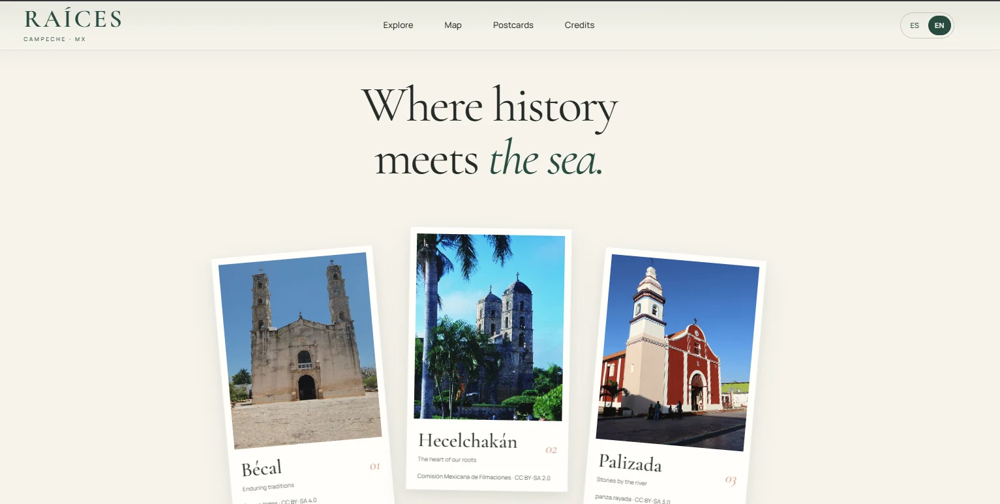
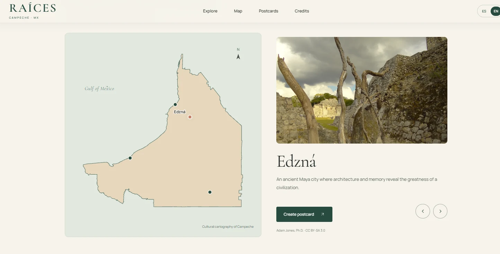
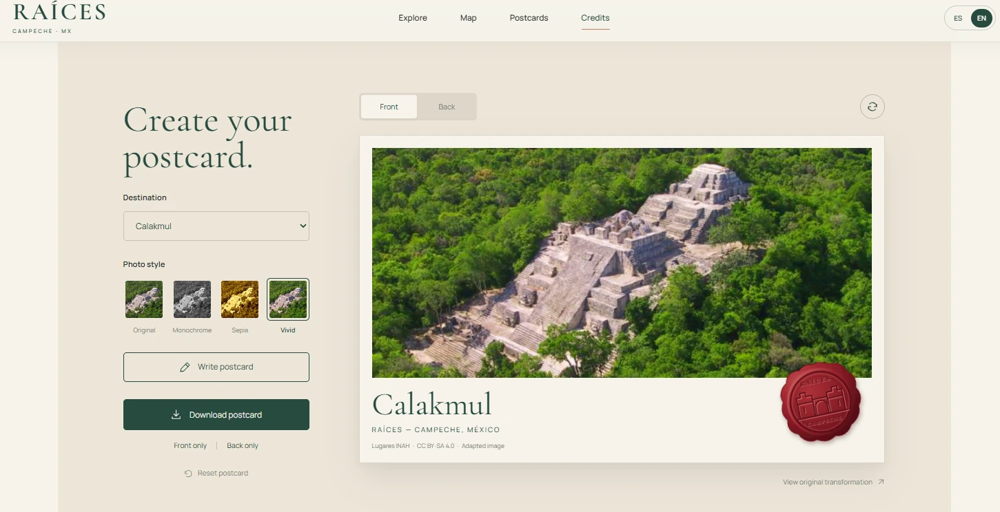
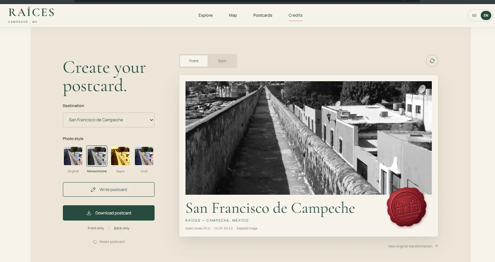
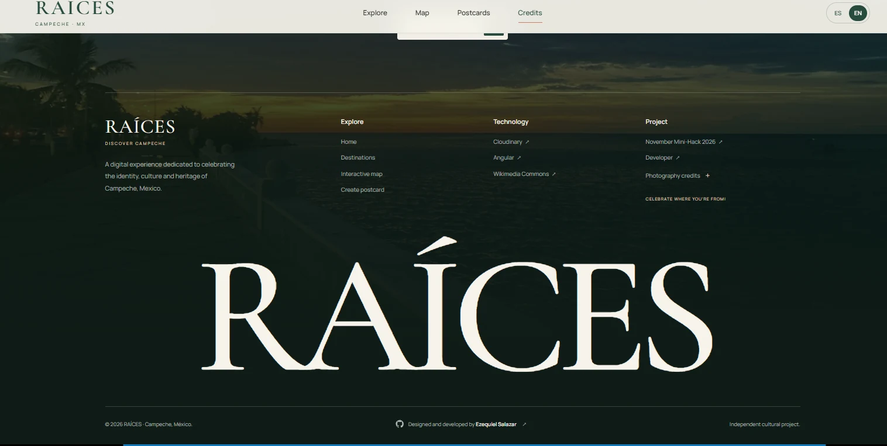
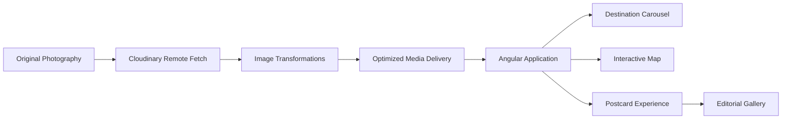
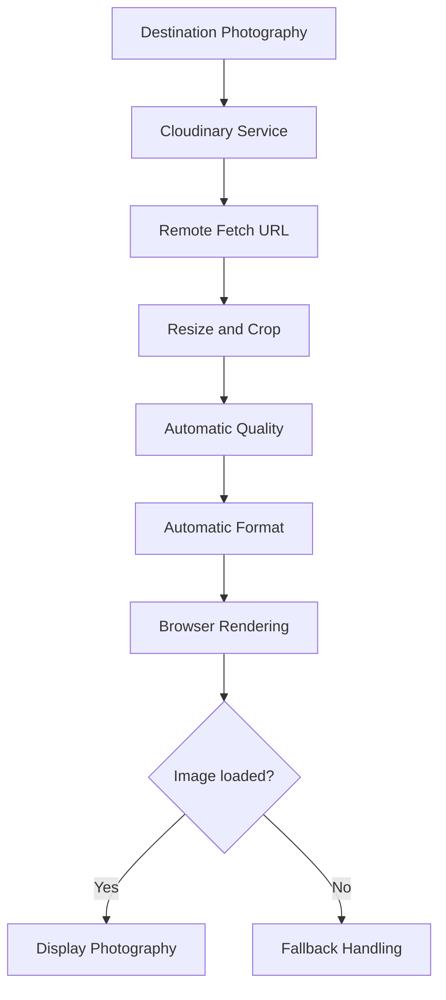
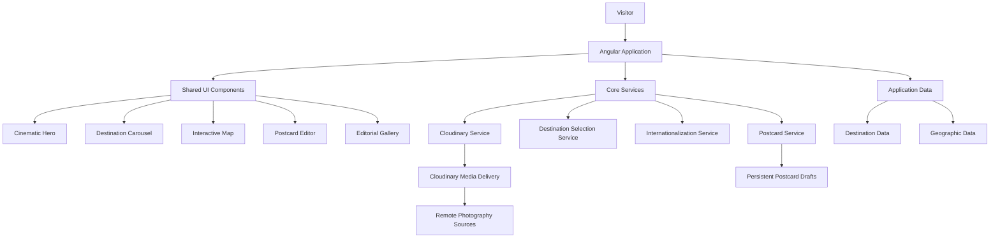
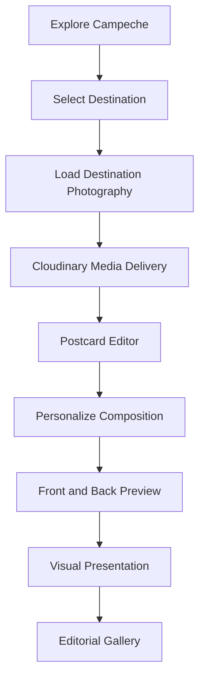

# RAÍCES — Discover Campeche

<div align="center">

  <h3>A land of living stories.</h3>

  <p>
    An immersive digital experience celebrating the history,
    landscapes, traditions, and cultural identity of Campeche, Mexico.
  </p>

  

  <br />
  <br />

  
  
  
  
  
  

  **Cloudinary November Mini-Hack 2026**

  *Celebrate Where You're From!*

  <a href="https://frontend-iche.vercel.app/">
    
  </a>

  <a href="https://www.youtube.com/watch?v=XDvKn_bbwCA">
    
  </a>

</div>

---

## Table of Contents

- [About the Project](#about-the-project)
- [Inspiration](#inspiration)
- [The Experience](#the-experience)
- [Key Features](#key-features)
- [Cloudinary Integration](#cloudinary-integration)
- [Documentation Asset Optimization](#documentation-asset-optimization)
- [Design Philosophy](#design-philosophy)
- [Technology Stack](#technology-stack)
- [Application Architecture](#application-architecture)
- [Getting Started](#getting-started)
- [Internationalization](#internationalization)
- [Responsive Experience](#responsive-experience)
- [Photography and Attribution](#photography-and-attribution)
- [Hackathon Submission](#hackathon-submission)
- [Future Improvements](#future-improvements)
- [Author](#author)
- [Acknowledgments](#acknowledgments)

---

## About the Project

**RAÍCES — Discover Campeche** is an interactive digital experience designed to celebrate the cultural heritage, natural beauty, and historical identity of Campeche, Mexico.

Rather than creating a conventional tourism website, RAÍCES presents the region through an immersive editorial experience where photography, storytelling, interactive exploration, and personalized digital postcards come together.

The project invites visitors to discover a territory shaped by ancient Maya civilizations, colonial architecture, tropical landscapes, traditional craftsmanship, riverside communities, and coastal traditions.

Through modern web technologies and Cloudinary-powered media delivery, RAÍCES explores how digital experiences can help share cultural identity with a global audience.

> Every place has a story. Every story has roots.

---

## Inspiration

Campeche is more than a destination.

It is a territory where centuries of history coexist with everyday traditions, colorful architecture, ancient archaeological sites, and the waters of the Gulf of Mexico.

As a developer from Campeche, I wanted to create an experience that celebrates the place I come from while combining technology, visual storytelling, and cultural identity.

RAÍCES is my way of sharing a part of Mexico that deserves to be discovered, remembered, and celebrated.

The project is built around three fundamental ideas:

- **Discover:** Explore the landscapes, communities, and cultural destinations of Campeche.
- **Remember:** Transform cultural exploration into meaningful visual memories.
- **Celebrate:** Share regional identity through creative digital experiences.



---

## The Experience

### 01 — Cinematic Introduction

The experience begins with an immersive cinematic hero that introduces the atmosphere and identity of Campeche.

The interface combines:

- Full-width cinematic video.
- Elegant editorial typography.
- Subtle entrance animations.
- Responsive layouts.
- Minimal visual distractions.
- Bilingual storytelling.

The objective is to establish an emotional connection with the region before visitors begin exploring individual destinations.


### 02 — Four Views of Campeche

An interactive destination carousel allows visitors to discover four essential perspectives of the region.

Each destination includes authentic photography, cultural descriptions, navigation controls, and access to the postcard creation experience.


| Destination | Cultural Identity |
| --- | --- |
| San Francisco de Campeche | Colonial history and architecture |
| Edzná | Ancient Maya heritage |
| Calakmul | Archaeology and tropical nature |
| Isla Aguada | Coastal landscapes and traditions |

These destinations introduce the diversity of Campeche through photography and editorial storytelling.

### 03 — Explore Our Roots

The interactive exploration section connects cultural storytelling with geographic discovery.

Visitors can navigate between destinations, discover their locations, read cultural descriptions, and select a place to create a personalized postcard.

The geographic experience combines interactive SVG visualization, destination data, and reactive application state.



The map creates a connection between the region's geography and its cultural narratives.

### 04 — Create a Memory

RAÍCES transforms cultural exploration into a personal and creative experience through an interactive digital postcard editor.

Inspired by traditional travel correspondence, the postcard experience allows visitors to create visual memories connected to the landscapes, architecture, and cultural identity of Campeche.

The experience combines:

- Destination photography.
- Reactive application state.
- Editorial compositions.
- Interactive postcard faces.
- Cloudinary-powered image processing.
- Responsive visual templates.

#### Interactive Postcard Editor



The postcard editor introduces a creative layer to the cultural exploration experience.

Visitors can interact with destination-based postcard compositions and personalize their digital memories.

The experience includes:

- Personalized destination-based postcards.
- Interactive front and back postcard faces.
- Three-dimensional postcard transitions.
- Editorial typography.
- Destination photography.
- A decorative Campeche-inspired wax seal.
- Persistent postcard drafts.
- Responsive postcard layouts.

#### Double-Sided Postcard Experience

Traditional postcards communicate through both imagery and written memories.

RAÍCES brings this concept into a digital environment through an interactive double-sided postcard experience.


The front and back compositions create a more expressive experience inspired by physical travel postcards.

The three-dimensional transitions reinforce the feeling of interacting with a tangible cultural object.

#### Monochrome Editorial Style

The monochrome presentation introduces an alternative visual interpretation of Campeche.

By reducing the emphasis on color, the composition highlights photography, typography, contrast, architectural details, and visual storytelling.



This visual approach complements the original editorial identity while providing an alternative creative experience.

#### Expanded Editorial Gallery

The editorial gallery has been expanded to represent seven cultural and natural destinations across Campeche.

The gallery uses dynamic Angular templates and responsive compositions to present a broader collection of regional stories.

| Destination | Cultural Identity |
| --- | --- |
| San Francisco de Campeche | Colonial architecture and fortified heritage |
| Edzná | Ancient Maya civilization |
| Calakmul | Archaeological heritage and tropical forests |
| Isla Aguada | Coastal landscapes and maritime traditions |
| Bécal | Traditional craftsmanship and cultural identity |
| Hecelchakán | Regional history and local traditions |
| Palizada | Riverside architecture and cultural heritage |

Each destination contributes a different perspective on the cultural diversity of Campeche.

The expanded gallery connects geographic discovery with editorial design and creative expression.

### 05 — A Cultural Farewell

The final section continues the editorial visual identity of the application through immersive photography, cultural messaging, navigation, and project information.


Rather than ending with a conventional footer, RAÍCES concludes the experience with a reflection on cultural identity and the importance of remembering where we come from.



---

## Key Features

| Feature | Description |
| --- | --- |
| Cinematic Hero | Immersive video-based introduction |
| Destination Carousel | Interactive navigation between featured destinations |
| Geographic Exploration | Interactive map with destination selection |
| Cultural Storytelling | Bilingual descriptions of regional heritage |
| Digital Postcards | Personalized visual memories inspired by Campeche |
| Double-Sided Postcards | Interactive front and back postcard compositions |
| 3D Postcard Transitions | Motion-driven postcard interactions |
| Editorial Gallery | Seven cultural and natural destinations |
| Monochrome Style | Alternative editorial postcard presentation |
| Persistent Drafts | Preservation of postcard creation state |
| Dynamic Templates | Reusable Angular postcard compositions |
| Cloudinary Integration | Remote image fetching, transformations, and optimized delivery |
| Responsive Design | Adaptable desktop, tablet, and mobile layouts |
| Internationalization | Spanish and English language support |
| Motion Design | Smooth transitions and subtle microinteractions |
| Photography Attribution | Original photography sources and licensing information |
| Optimized Documentation | WebP screenshots for project documentation |

---

## Cloudinary Integration

Cloudinary is a central part of the RAÍCES media experience.

The application uses Cloudinary to transform and deliver destination photography dynamically, reducing the need to maintain multiple manually processed versions of the same image.

Media delivery is particularly important in an experience where photography plays a fundamental role in cultural storytelling.

### Remote Image Fetching

Destination photographs originate from external photography sources, including Wikimedia Commons.

Cloudinary Remote Fetch enables the application to request transformed versions of these images through a centralized media delivery service.

This approach separates the original photography sources from the media transformation and delivery process.

### Dynamic Image Transformations

Images are processed using transformation parameters that control dimensions, cropping, quality, and delivery format.

| Transformation | Purpose |
| --- | --- |
| `c_fill` | Fill the requested image dimensions |
| `w_1200` | Set the requested image width |
| `h_744` | Set the requested image height |
| `q_auto` | Automatically select image quality |
| `f_auto` | Automatically select a supported image format |

Example transformation URL:

```text
https://res.cloudinary.com/<cloud-name>/image/fetch/c_fill,w_1200,h_744,q_auto,f_auto/<remote-image-url>
```

The remote image URL should be appropriately encoded when constructing the delivery URL.

### Image Delivery Flow



### Media Transformation Pipeline



### Why Cloudinary?

Cloudinary supports the project's visual experience by providing:

- Centralized image transformation.
- Dynamic image resizing.
- Automatic quality optimization.
- Automatic image format selection.
- Remote media delivery.
- Image processing for creative experiences.
- Reusable media transformation URLs.

The application also includes fallback handling for destination photography when remote image delivery encounters an error.

By combining Cloudinary with Angular, RAÍCES can focus on cultural storytelling and creative interaction while using a dedicated media delivery infrastructure.

### Cloudinary Resources

- [Cloudinary Documentation](https://cloudinary.com/documentation)
- [Image Transformations](https://cloudinary.com/documentation/image_transformations)
- [Fetch Remote Images](https://cloudinary.com/documentation/fetch_remote_images)
- [Image Optimization](https://cloudinary.com/documentation/image_optimization)

---

## Documentation Asset Optimization

The visual documentation of RAÍCES includes original PNG screenshots and optimized WebP versions.

WebP assets are used throughout this README to reduce documentation image weight while preserving the original image dimensions and visual detail.

### Asset Organization

| Format | Purpose |
| --- | --- |
| PNG | Original project screenshots |
| WebP | Optimized documentation and technical articles |

The optimized screenshots are stored in:

```text
public/assets/webp/
```

### Documentation Image Inventory

| Asset | Description |
| --- | --- |
| `hero.webp` | Cinematic homepage |
| `wherehistory.webp` | Cultural introduction |
| `fourview.webp` | Interactive destination carousel |
| `Explore.webp` | Interactive exploration map |
| `memory.webp` | Digital postcard editor |
| `memory2.webp` | Double-sided postcard experience |
| `memorymonochrome.webp` | Monochrome editorial presentation |
| `footer1.webp` | Cultural closing section |
| `footer2.webp` | Footer and project credits |

### Documentation Optimization Workflow


The documentation screenshots are optimized separately from the application's Cloudinary-powered media delivery pipeline.

This distinction allows the project to maintain original documentation assets while providing lighter versions for public technical content.

---

## Design Philosophy

RAÍCES follows a contemporary editorial design inspired by cultural magazines, photography exhibitions, traditional travel postcards, and immersive travel experiences.

The interface prioritizes photography, typography, whitespace, composition, and storytelling rather than excessive decorative elements.

The design aims to establish an emotional connection between the visitor and the cultural identity of Campeche.

### Color Palette

| Color | Hex | Inspiration |
| --- | --- | --- |
| Colonial White | `#F6F3EB` | Historic colonial architecture |
| Forest Green | `#284B40` | The Maya jungle |
| Natural Sand | `#E6D6BD` | Limestone and ancient structures |
| Terracotta | `#C47D65` | Traditional architecture |
| Coastal Blue | `#709B9B` | The Gulf of Mexico |
| Charcoal | `#262B28` | Editorial typography |

### Typography

- **Cormorant Garamond** — Editorial headings and cultural storytelling.
- **Manrope** — Navigation, descriptions, and interface elements.

The combination establishes a visual hierarchy that balances expressive cultural narratives with functional interface design.

### Motion Design

Animations are designed to complement the experience without distracting from its cultural content.

The visual language includes:

- Smooth entrance animations.
- Destination transitions.
- Interactive navigation.
- Subtle hover effects.
- Responsive microinteractions.
- Three-dimensional postcard transitions.
- Editorial gallery interactions.
- Reduced-motion considerations.

### Editorial Postcard Design

The postcard experience draws inspiration from traditional printed correspondence and contemporary editorial compositions.

Its visual identity combines:

- Destination photography.
- Expressive typography.
- Traditional postcard layouts.
- Decorative cultural details.
- A Campeche-inspired wax seal.
- Front and back compositions.
- Monochrome visual interpretations.

These elements reinforce the connection between digital interaction and physical cultural memories.

---

## Technology Stack

### Frontend

| Technology | Purpose |
| --- | --- |
| Angular 22 | Application framework |
| TypeScript | Type-safe application development |
| Angular Signals | Reactive application state |
| Angular Templates | Dynamic editorial compositions |
| Tailwind CSS | Utility-based styling |
| CSS | Custom editorial layouts and animations |
| GSAP | Motion design |
| SVG | Interactive geographic visualization |
| HTML5 Video | Cinematic media experience |

### Media Infrastructure

| Technology | Purpose |
| --- | --- |
| Cloudinary | Media transformations and delivery |
| Wikimedia Commons | Source photography |
| GeoJSON | Geographic data |
| WebP | Optimized documentation screenshots |

### Development and Deployment

| Technology | Purpose |
| --- | --- |
| pnpm | Dependency management |
| Git | Version control |
| GitHub | Source code management |
| Vercel | Frontend deployment |

---

## Application Architecture

RAÍCES follows a modular Angular architecture with reusable components, centralized services, reactive application state, and separated application data.

### High-Level Architecture



### Project Structure

```text
frontend/
├── public/
│   ├── assets/
│   │   ├── Explore.png
│   │   ├── footer1.png
│   │   ├── footer2.png
│   │   ├── fourview.png
│   │   ├── hero.png
│   │   ├── memory.png
│   │   ├── memory2.png
│   │   ├── memorymonochrome.png
│   │   ├── wherehistory.png
│   │   └── webp/
│   │       ├── Explore.webp
│   │       ├── footer1.webp
│   │       ├── footer2.webp
│   │       ├── fourview.webp
│   │       ├── hero.webp
│   │       ├── memory.webp
│   │       ├── memory2.webp
│   │       ├── memorymonochrome.webp
│   │       └── wherehistory.webp
│   ├── maps/
│   │   └── campeche.geojson
│   └── hero.mp4
│
├── src/
│   ├── app/
│   │   ├── core/
│   │   │   └── services/
│   │   ├── data/
│   │   ├── features/
│   │   ├── shared/
│   │   │   └── components/
│   │   ├── app.config.ts
│   │   ├── app.routes.ts
│   │   ├── app.html
│   │   ├── app.css
│   │   └── app.ts
│   ├── index.html
│   ├── main.ts
│   └── styles.css
│
├── angular.json
├── package.json
├── pnpm-lock.yaml
├── vercel.json
└── README.md
```

### Core Services

| Service | Responsibility |
| --- | --- |
| `CloudinaryService` | Image transformations and fallback handling |
| `DestinationSelectionService` | Shared destination selection |
| `I18nService` | Spanish and English language management |
| `PostcardService` | Postcard creation state and interactions |

### Postcard Experience Flow



The architecture separates destination data, media delivery, application state, and presentation logic to support reusable components and future improvements.

---

## Getting Started

### Prerequisites

Before running the project locally, make sure you have:

- Node.js compatible with Angular 22.
- pnpm.
- Git.
- A modern web browser.

### Installation

Clone the repository:

```bash
git clone https://github.com/Ezequie1Sc/frontend.git
```

Navigate to the project directory:

```bash
cd frontend
```

Install the dependencies:

```bash
pnpm install
```

Start the development server:

```bash
pnpm start
```

Open the application in your browser:

```text
http://localhost:4200
```

### Production Build

Generate the production build:

```bash
pnpm build
```

### Cloudinary Configuration

The Cloudinary media configuration is managed through the application's Cloudinary service.

To use a different Cloudinary product environment, update the public cloud name in:

```text
src/app/core/services/cloudinary.service.ts
```

Remote Fetch must be permitted by the corresponding Cloudinary product environment.

Private API secrets must never be exposed in frontend source code or committed to the repository.

### Live Deployment

The application is deployed using Vercel.

- **Live application:** [Explore RAÍCES](https://frontend-iche.vercel.app/)
- **Source code:** [GitHub Repository](https://github.com/Ezequie1Sc/frontend)
- **Video demonstration:** [Watch on YouTube](https://www.youtube.com/watch?v=XDvKn_bbwCA)

---

## Internationalization

RAÍCES is designed to be accessible to both local and international visitors.

The application supports:

- Spanish (ES).
- English (EN).

Visitors can switch languages directly from the navigation interface.

Cultural descriptions, navigation labels, interface actions, and editorial content adapt to the selected language.

Internationalization helps make the cultural heritage of Campeche available to a broader audience while preserving its regional identity.

---

## Responsive Experience

The application is designed for multiple screen sizes, including:

- Desktop computers.
- Laptops.
- Tablets.
- Mobile devices.

Layouts adapt to the available screen space while preserving the editorial identity and core exploration experience.

Responsive considerations include:

- Adaptive typography.
- Flexible destination layouts.
- Responsive media compositions.
- Mobile-friendly navigation.
- Interactive geographic visualization.
- Adaptive postcard compositions.
- Responsive editorial galleries.

The objective is to maintain a consistent cultural experience across different devices.

---

## Photography and Attribution

RAÍCES uses externally sourced photography to represent the cultural and geographic identity of Campeche.

Original photography remains the property of its respective authors and is subject to its original licensing conditions.

| Destination | Photographer / Contributor | Source |
| --- | --- | --- |
| San Francisco de Campeche | Adam Jones, Ph.D. | [Wikimedia Commons](https://commons.wikimedia.org/wiki/File:Old_City_Walls_and_Colonial_Facades_-_Campeche_-_Mexico.jpg) |
| Edzná | Adam Jones, Ph.D. | [Wikimedia Commons](https://commons.wikimedia.org/wiki/File:Edzna_Archaeological_Site_with_Flash_-_Campeche_State_-_Mexico.jpg) |
| Calakmul | Lugares INAH | [Wikimedia Commons](https://commons.wikimedia.org/wiki/File:Calakmul_Structure_2.jpg) |
| Isla Aguada | Bernard DUPONT | [Wikimedia Commons](https://commons.wikimedia.org/wiki/File:Colorful_Sea_Side_-_Isla_Aguada_Campeche.jpg) |

Additional attribution information is available within the application and its destination data.

Photographic transformations do not transfer ownership of the original media.

Adapted postcards, transformed photographs, and documentation screenshots containing third-party media must comply with the applicable source image licenses.

---

## Hackathon Submission

<div align="center">

  <h3>Cloudinary November Mini-Hack 2026</h3>

  <p>Celebrate Where You're From!</p>

</div>

| Information | Details |
| --- | --- |
| Project | RAÍCES — Discover Campeche |
| Event | Cloudinary November Mini-Hack 2026 |
| Theme | Celebrate Where You're From! |
| Region | Campeche, Mexico |
| Country | Mexico |
| Category | Cultural exploration and creative media |
| Media Platform | Cloudinary |
| Developer | Orlando Ezequiel Salazar Cruz |
| Frontend Framework | Angular 22 |
| Deployment | Vercel |

### The Challenge

The challenge encourages developers to celebrate the places they come from through creative technology and media experiences.

RAÍCES responds to this theme by transforming the cultural identity of Campeche into an interactive digital journey.

By combining authentic photography, geographic exploration, cinematic storytelling, and personalized postcards, the project creates a connection between technology, cultural heritage, and personal identity.

### Project Objectives

| Objective | Implementation |
| --- | --- |
| Celebrate local culture | Interactive exploration of Campeche |
| Encourage discovery | Destination carousel and geographic visualization |
| Integrate creative media | Cloudinary-powered photography |
| Promote personal expression | Interactive digital postcards |
| Deliver visual storytelling | Editorial design and cinematic presentation |
| Reach international audiences | Spanish and English support |

### Submission Resources

| Resource | Link |
| --- | --- |
| Live Application | [Explore RAÍCES](https://frontend-iche.vercel.app/) |
| Source Code | [GitHub Repository](https://github.com/Ezequie1Sc/frontend) |
| Video Demonstration | [YouTube](https://www.youtube.com/watch?v=XDvKn_bbwCA) |
| Media Infrastructure | [Cloudinary](https://cloudinary.com/) |

---

## Development Evolution

RAÍCES has evolved through multiple development iterations, expanding its original cultural exploration experience with new creative and editorial features.

### Initial Experience

- Cinematic introduction.
- Cultural storytelling.
- Featured destination carousel.
- Interactive geographic exploration.
- Initial postcard creation experience.
- Cloudinary media integration.

### Premium Experience

- Refined editorial visual identity.
- Improved interactive layouts.
- Enhanced motion design.
- Responsive visual compositions.

### Premium Postcard Experience

- Double-sided postcard compositions.
- Three-dimensional postcard interactions.
- Campeche-inspired wax seal.
- Reactive postcard editor state.
- Persistent postcard drafts.
- Additional cultural destinations.

### Expanded Editorial Gallery

- Seven cultural and natural destinations.
- Dynamic Angular postcard templates.
- Expanded editorial compositions.
- Improved responsive gallery layouts.
- Monochrome visual presentation.

### Documentation Refresh

- Updated project screenshots.
- Nine optimized WebP documentation assets.
- Expanded technical documentation.
- Updated architecture diagrams.
- Improved project presentation.

---

## Future Improvements

Potential future developments include:

- Additional cultural destinations.
- Expanded photography collections.
- More detailed geographic exploration.
- Additional postcard templates.
- Interactive cultural timelines.
- Digital travel collections.
- Expanded accessibility features.
- Additional internationalization options.
- Further media delivery optimization.
- Expanded cultural storytelling experiences.

These improvements would continue the project's objective of connecting cultural heritage with creative technology.

---

## Author

<div align="center">

  

  <h3>Orlando Ezequiel Salazar Cruz</h3>

  <p>
    Computer Systems Engineering Student<br />
    Full Stack Developer<br />
    Campeche, Mexico
  </p>

  <p>
    Interested in software engineering, creative development,
    open-source technologies, and meaningful digital experiences.
  </p>

  <a href="https://github.com/Ezequie1Sc">
    
  </a>

  <a href="https://dev.to/ezequie1sc">
    
  </a>

  <a href="https://ezequiel-dev-ia.vercel.app/">
    
  </a>

</div>

---

## Acknowledgments

Special thanks to:

- Cloudinary for providing the media infrastructure and creative challenge.
- The Cloudinary developer community for encouraging creative technology.
- Wikimedia Commons contributors for sharing cultural photography.
- The communities that preserve the history and traditions of Campeche.
- Everyone working to protect and celebrate Mexico's cultural heritage.

RAÍCES is a celebration of the places, people, landscapes, and stories that shape our identity.

---

<div align="center">

  <h1>RAÍCES</h1>

  <h3>Discover the land. Remember the stories. Celebrate your roots.</h3>

  <p>
    Technology can do more than solve problems.<br />
    It can preserve memories, connect communities,<br />
    and bring our stories to the world.
  </p>

  <p><strong>Designed and developed in Campeche, Mexico.</strong></p>

  <sub>2026 · RAÍCES — Discover Campeche</sub>

</div>
